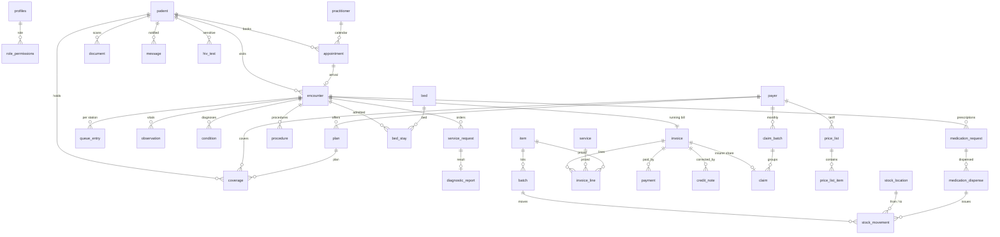
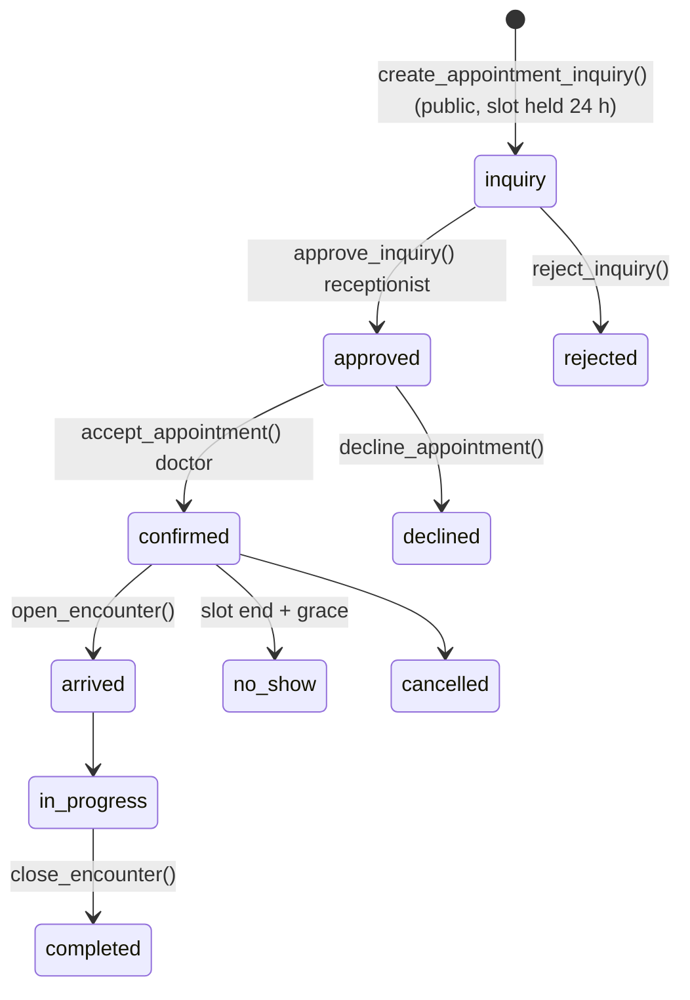
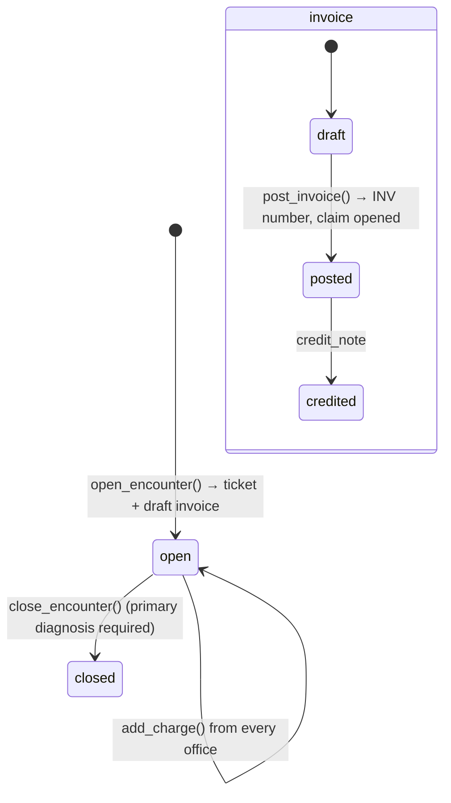

# Muhazi Medical Clinic System — database design and system flow

PostgreSQL (Supabase) is the system of record. This document explains the structure of the
database, the rules it enforces, and how one patient visit moves through it. The source of truth
is the SQL in [supabase/migrations](../supabase/migrations/); `pnpm db:check` proves everything
described here on every change. Accounts, sign-in and the manager's employee controls are in
[security-and-access.md](security-and-access.md).

## 1. Principles

| Principle                                    | How the schema does it                                                                                                                                                         |
| -------------------------------------------- | ------------------------------------------------------------------------------------------------------------------------------------------------------------------------------ |
| One visit, one record, one invoice           | `encounter` is the root of a visit; every clinical and billing row points to it; a draft `invoice` is created the moment an encounter opens                                    |
| Prices enter office by office                | `add_charge()` writes an `invoice_line` with office, performer, price origin (preset / manual / pharmacy) and the frozen coverage %                                            |
| Nothing is deleted, nothing posted is edited | `deleted_at` soft deletes; triggers refuse changes to posted invoices, verified reports and submitted claim batches; corrections are new rows (`credit_note`, `supersedes_id`) |
| Every read and write is accountable          | `audit_event` (partitioned by month) receives before/after of every write; `log_access()` records reads and break-glass                                                        |
| Human numbers come from the hub              | UUIDs are made anywhere; `MMC-000123`, `INV-2026-000001`, `A-001`, `CLM-RAMA-2026-10` come from `next_number()` here                                                           |
| Quantities are ledgers                       | Stock on hand is a sum of `stock_movement`; cash is a sum of `payment`; beds are `bed_stay` rows                                                                               |
| Least privilege                              | Row-level security on every table through `has_perm('<key>')`; the public site is anonymous and can only read two views and call one function                                  |
| Offline-ready                                | Every table carries `id`, `device_id`, `received_at`, `version`; sync rules per role are added with PowerSync                                                                  |

## 2. Entity overview

## 3. Tables by area

Every business table also has the common columns of doc §10.1: `id uuid`, `created_at`,
`created_by`, `device_id`, `received_at`, `updated_at`, `updated_by`, `deleted_at`, `version`.

### 3.1 Identity and permissions

| Table              | Key columns                                                                                                | Notes                                                                  |
| ------------------ | ---------------------------------------------------------------------------------------------------------- | ---------------------------------------------------------------------- |
| `profiles`         | `id` = auth user, `username`, `full_name`, `role`, `station`, `dashboard`, `head_of`, `language`, `active` | Created by trigger from the Auth user's metadata                       |
| `role_permissions` | `role`, `permission`                                                                                       | The matrix in §6                                                       |
| `device`           | `name`, `platform`, `user_id`, `enrolled_at`, `revoked_at`, `last_sync_at`                                 | Device revocation (doc §5.12)                                          |
| `setting`          | `key`, `value jsonb`                                                                                       | `clinic.profile`, `clinic.hours`, `numbering`, `booking`, `compliance` |
| `translation`      | `key`, `language`, `text`                                                                                  | Translation editor                                                     |
| `audit_event`      | `actor_id`, `action`, `entity`, `entity_id`, `before`, `after`, `reason`, `at`                             | Partitioned by month; append-only                                      |
| `number_series`    | `key`, `year`, `last`                                                                                      | Atomic counters behind `next_number()`                                 |

### 3.2 Patients and payers

| Table           | Key columns                                                                                                                                                                                                                                     | Notes                                                                   |
| --------------- | ----------------------------------------------------------------------------------------------------------------------------------------------------------------------------------------------------------------------------------------------- | ----------------------------------------------------------------------- |
| `patient`       | `file_number` (hub), names, `sex`, `birth_date`, `age_estimated`, `national_id` (16 digits), `phone_1/2`, `preferred_channel`, `language`, village address, `ubudehe_category`, guardian, `blood_group`, `flags`, three consents, `merged_into` | Indexes on phone, lower(surname), file number; duplicate check function |
| `patient_alias` | `file_number` → `patient_id`                                                                                                                                                                                                                    | Old numbers keep working after a merge                                  |
| `payer`         | `code`, `name`, `type` (cash, rssb_rama, cbhi, mmi, private, employer), `cycle_day`, `required_docs`                                                                                                                                            | Cash is a payer                                                         |
| `plan`          | `payer_id`, `coverage_pct`, `pct_by_group`, `annual_cap`, `exclusions`, `preauth_rules`                                                                                                                                                         | e.g. RAMA 85 %, MMI dental 50 %                                         |
| `coverage`      | `patient_id`, `payer_id`, `plan_id`, `member_number`, validity, `card_blob_id`                                                                                                                                                                  | Several per patient; one chosen per encounter                           |

### 3.3 Catalogue and pricing

| Table             | Key columns                                                                                               | Notes                            |
| ----------------- | --------------------------------------------------------------------------------------------------------- | -------------------------------- |
| `service`         | `code`, names in 3 languages, `service_group`, `tax_type`, `allow_manual_price`, `booking_category`       | The manager's preset treatments  |
| `item`            | `code`, generic/brand, strength, form, `pack_size`, `controlled`, `reorder_level`                         | Medicines, consumables, reagents |
| `price_list`      | `payer_id` (null = cash), `effective_from/to`                                                             | Old invoices never change        |
| `price_list_item` | `price_list_id`, `service_id` xor `item_id`, `price`                                                      |                                  |
| `practitioner`    | `code`, `names`, `title`, `specialty`, `slot_minutes`, `working_hours jsonb`, `categories[]`, `languages` | Owns a public calendar           |

`price_for(service, item, payer)` returns the latest effective price of the payer, falling back
to the cash list with a flag; `coverage_pct_for(plan, group)` applies per-group overrides.

### 3.4 Visits

| Table                                 | Key columns                                                                                                                                               | Notes                                                         |
| ------------------------------------- | --------------------------------------------------------------------------------------------------------------------------------------------------------- | ------------------------------------------------------------- |
| `appointment`                         | `patient_id`, `practitioner_id`, `starts_at`, `ends_at`, `status`, `source`, `hold_until`, approval/acceptance stamps, public contact fields, `reference` | Unique slot per practitioner while approved/confirmed/arrived |
| `encounter`                           | `patient_id`, `type`, `arrived_at`, `practitioner_id`, `triage_level`, `coverage_id`, `appointment_id`, `status`, closure stamps                          | Root of the visit                                             |
| `queue_entry`                         | `encounter_id`, `station`, `ticket_no`, `priority`, `called_at`, `started_at`, `finished_at`                                                              | One per station                                               |
| `observation`                         | `encounter_id`, `code`, `value_num/text`, `unit`, `flag`, `supersedes_id`                                                                                 | Append-only vitals and results                                |
| `condition`                           | `encounter_id`, `icd10_code`, `text`, `type`, `provisional`                                                                                               | Primary required to close                                     |
| `service_request`                     | `encounter_id`, `category` (lab, imaging), `service_id`, `status`, `sample_id`                                                                            | Creates worklist + charge                                     |
| `diagnostic_report`                   | `service_request_id`, `findings`, `impression`, `verified_by/at`, `attachments`                                                                           | Immutable once verified                                       |
| `procedure`                           | `encounter_id`, `service_id`, `consent_blob_id`, `note`, `tooth_number`, `follow_up_date`                                                                 | Dental uses FDI tooth numbers                                 |
| `medication_request`                  | `encounter_id`, `item_id`, dose, route, frequency, `duration_days`, `quantity`, `allergy_override_reason`                                                 | Prescription lines                                            |
| `medication_dispense`                 | `medication_request_id`, `encounter_id`, `item_id`, `batch_id`, `quantity`, `substitution_reason`                                                         | Written by `dispense_fefo()`                                  |
| `bed`, `bed_stay`                     | `name`, `status`; `encounter_id`, `bed_id`, admitted/discharged, `charge_mode`                                                                            | One open stay per bed                                         |
| `vaccination`, `fp_event`, `hiv_test` | programme fields, `next_due`, `register jsonb`                                                                                                            | `hiv_test` is behind the `sensitive.*` permissions            |
| `document`                            | `patient_id`, `encounter_id`, `type`, `storage_key`                                                                                                       | Files live in Supabase Storage                                |

### 3.5 Stock

| Table                                                | Key columns                                                                                              | Notes                                                                   |
| ---------------------------------------------------- | -------------------------------------------------------------------------------------------------------- | ----------------------------------------------------------------------- |
| `stock_location`                                     | `name`, `type`                                                                                           | main store, pharmacy, nursing, lab, theatre                             |
| `supplier`, `purchase_order(_line)`, `goods_receipt` |                                                                                                          | Purchasing                                                              |
| `batch`                                              | `item_id`, `batch_no`, `expiry`, `unit_cost`, `supplier_id`                                              | FEFO picks the earliest expiry                                          |
| `stock_movement`                                     | `item_id`, `batch_id`, `from_location_id`, `to_location_id`, `quantity`, `type`, `reason`, `dispense_id` | The ledger; `stock_on_hand` and `items_below_reorder` are views over it |

### 3.6 Billing and claims

| Table          | Key columns                                                                                                                                                                                                         | Notes                                             |
| -------------- | ------------------------------------------------------------------------------------------------------------------------------------------------------------------------------------------------------------------- | ------------------------------------------------- |
| `invoice`      | `encounter_id` (unique), `number` (hub), `status` draft/posted/credited, `payer_id`, `coverage_id`, `total`, `patient_share`, `insurer_share`, `posted_at/by`, `provisional_no`                                     | Immutable after posting                           |
| `invoice_line` | `invoice_id`, `service_id` xor `item_id`, `description`, `quantity`, `unit_price`, `coverage_pct`, shares, `office`, `performed_by`, `entered_by`, `entered_for`, `source_type/id`, `price_origin`, `manual_reason` | Per-office charging model                         |
| `payment`      | `invoice_id`, `method` (cash, momo, airtel, card, bank, insurer, credit, deposit), `amount`, `reference`, `payer_phone`, `cashier_id`, `day_close_id`                                                               | Split payments allowed                            |
| `credit_note`  | `invoice_id`, `number`, `lines`, `total`, `reason`, `approver_id`, `refund_payment_id`                                                                                                                              | The only way to correct a posted invoice          |
| `claim`        | `invoice_id`, `payer_id`, `member_number`, `amount`, `status`, `rejection_reason`, `batch_id`, `resubmitted_in`, `missing_docs`                                                                                     | Opened by `post_invoice()` when insurer share > 0 |
| `claim_batch`  | `payer_id`, period, `number`, `status`, `submitted_at`, totals                                                                                                                                                      | Cannot reopen once submitted                      |
| `day_close`    | `date`, `cashier_id`, `expected`, `counted`, `variance`                                                                                                                                                             | Z-report                                          |

### 3.7 Communication

| Table             | Key columns                                                                                     | Notes                                                       |
| ----------------- | ----------------------------------------------------------------------------------------------- | ----------------------------------------------------------- |
| `template`        | `key`, `language`, `body`, `whatsapp_template_name`                                             | Three languages; facts only, never clinical detail          |
| `message`         | `patient_id`, `channel`, `to_address`, `template_key`, `body`, `status`, `provider_ref`, `cost` | `queue_message()` picks the patient's channel, SMS fallback |
| `internal_task`   | `encounter_id`, `assigned_role/to`, `due_at`, `title`, `done_at`                                | Doctor → nurse tasks                                        |
| `hmis_submission` | `period`, `data`, `frozen_at`                                                                   | Monthly form, frozen                                        |

## 4. State machines

### Appointment (doc §6)

### Encounter and invoice (doc §3, §4)

### Claim

`open` (posted invoice with insurer share) → `batched` (`create_claim_batch()`) → `submitted` →
`paid` | `rejected` → `resubmitted` (next batch) | `written_off`.

## 5. One visit, table by table (doc §4.5 worked example)

| Step                                     | Function / table                                     | Result in the test suite                   |
| ---------------------------------------- | ---------------------------------------------------- | ------------------------------------------ |
| Reception registers Niyonzima Jean Bosco | `insert patient` → trigger `assign_file_number`      | `MMC-000001`                               |
| RSSB RAMA card captured                  | `insert coverage` (plan 85 %)                        |                                            |
| Walk-in ticket                           | `open_encounter(patient, 'opd', 'triage', coverage)` | `A-001`, draft invoice                     |
| Nurse vitals, triage yellow              | `insert observation`, `update encounter`             | receptionist refused by RLS                |
| Doctor charges consultation              | `add_charge(enc, 'consultation', CONS-GEN)`          | 5,000 (RSSB tariff)                        |
| Doctor orders malaria RDT + FBC          | `add_charge` × 2                                     | 2,000 + 4,000                              |
| Doctor records diagnosis B54             | `insert condition (primary)`                         |                                            |
| Nurse types injection price              | `add_charge(…, manual 1,000, reason)`                | refused without a reason                   |
| Pharmacist dispenses 21 × amoxicillin    | `dispense_fefo()` then `add_charge(item, 21)`        | stock 1000 → 979, 6,300                    |
| Running bill                             | `recompute_invoice()`                                | 18,300 = 2,745 + 15,555                    |
| Cashier takes MoMo and posts             | `record_payment()`, `post_invoice()`                 | `INV-2026-000001`, balance 0, claim 15,555 |
| Any later edit                           | triggers                                             | refused                                    |
| Month end                                | `create_claim_batch(RAMA, period)`                   | `CLM-RAMA-2026-10`                         |

## 6. Permission matrix

| Key                                                   | receptionist | cashier |  nurse  | doctor  | sonographer | lab_tech | pharmacist | manager |
| ----------------------------------------------------- | :----------: | :-----: | :-----: | :-----: | :---------: | :------: | :--------: | :-----: |
| patient.read / write                                  |    ✓ / ✓     |  ✓ / –  |  ✓ / ✓  |  ✓ / ✓  |    ✓ / –    |  ✓ / –   |   ✓ / –    |  ✓ / ✓  |
| appointment.read / write / approve / accept           |   ✓ ✓ ✓ –    |    –    | ✓ – – – | ✓ – – ✓ |      –      |    –     |     –      |   all   |
| queue.read / write                                    |      ✓       |    ✓    |    ✓    |    ✓    |      ✓      |    ✓     |     ✓      |    ✓    |
| clinical.read / write                                 |      –       |    –    |  ✓ / ✓  |  ✓ / ✓  |    ✓ / –    |    –     |     –      |  ✓ / –  |
| sensitive.read / write (HIV)                          |      –       |    –    |    ✓    |    ✓    |      –      |    –     |     –      |    –    |
| orders.read / write                                   |      –       |    –    |  ✓ / –  |  ✓ / ✓  |    ✓ / ✓    |  ✓ / ✓   |     –      |  ✓ / –  |
| prescription.read                                     |      –       |    –    |    ✓    |    ✓    |      –      |    –     |     ✓      |    ✓    |
| charge.write / manual                                 |      –       |  ✓ / –  |  ✓ / –  |  ✓ / ✓  |    ✓ / –    |  ✓ / –   |   ✓ / –    |  ✓ / ✓  |
| billing.read / write                                  |    ✓ / –     |  ✓ / ✓  |    –    |    –    |      –      |    –     |     –      |  ✓ / ✓  |
| claims.read / write                                   |      –       |  ✓ / –  |    –    |    –    |      –      |    –     |     –      |  ✓ / ✓  |
| stock.read / write / dispense                         |      –       |    –    |  ✓ – –  |    –    |      –      |  ✓ ✓ –   |   ✓ ✓ ✓    |   all   |
| catalogue.write, item_price.write                     |      –       |    –    |    –    |    –    |      –      |    –     | item_price |  both   |
| settings.write, staff.write, audit.read, reports.read |      –       |    –    |    –    |    –    |      –      |    –     |     –      |    ✓    |

Everyone has `catalogue.read`, `settings.read`, `staff.read`. The anonymous role has none of
these: it reads `public_practitioners`, `public_booked_slots`, `public_service_lines`,
`public_payers`, calls `public_clinic_info()`, `public_clinic_status()` and
`create_appointment_inquiry()`.

## 7. The backend API (SQL functions called with `supabase.rpc`)

| Function                                                                                                                     | Who                     | Purpose                                                                                     |
| ---------------------------------------------------------------------------------------------------------------------------- | ----------------------- | ------------------------------------------------------------------------------------------- |
| `create_appointment_inquiry(code, starts_at, name, phone, insurer, category, note, channel)`                                 | public                  | Validates phone and working hours, refuses taken slots, holds 24 h, returns `MMC-YYYY-NNNN` |
| `approve_inquiry(id, patient_id)`, `reject_inquiry(id, reason)`                                                              | receptionist            |                                                                                             |
| `accept_appointment(id)`, `decline_appointment(id, reason)`                                                                  | doctor                  |                                                                                             |
| `open_encounter(patient, type, station, coverage, appointment, practitioner)`                                                | reception / any station | Ticket + draft invoice, marks the appointment arrived                                       |
| `close_encounter(id)`                                                                                                        | clinical                | Requires a primary diagnosis                                                                |
| `add_charge(encounter, office, service, item, qty, manual_price, reason, performed_by, entered_for, source_type, source_id)` | every office            | The running bill                                                                            |
| `dispense_fefo(encounter, item, qty, location, request, substitution_reason)`                                                | pharmacist              | Earliest expiry first; refuses if short                                                     |
| `record_payment(invoice, method, amount, reference, payer_phone)`                                                            | cashier                 | Reference required for MoMo / Airtel / card / bank                                          |
| `post_invoice(invoice)`                                                                                                      | cashier                 | Number, immutability, claim                                                                 |
| `invoice_balance(invoice)`                                                                                                   | billing                 | Patient share minus payments                                                                |
| `create_claim_batch(payer, from, to)`                                                                                        | manager                 | Monthly batch                                                                               |
| `queue_message(patient, template_key, body)`                                                                                 | reception               | Preferred channel with SMS fallback                                                         |
| `find_patient_duplicates(id, phone, surname, given, birth)`                                                                  | reception               | Before saving a new file                                                                    |
| `merge_patients(keep, merge)`                                                                                                | manager                 | Old number becomes an alias                                                                 |
| `log_access(entity, id, action, reason)`                                                                                     | app                     | Read and break-glass audit                                                                  |

## 8. Numbering

| Series              | Format                             | Function / trigger                       |
| ------------------- | ---------------------------------- | ---------------------------------------- |
| Patient file        | `MMC-000123`                       | `assign_file_number` trigger             |
| Queue ticket        | `A-001` per station prefix per day | `open_encounter()`                       |
| Invoice             | `INV-2026-000001`                  | `post_invoice()`                         |
| Inquiry             | `MMC-2026-0001`                    | `create_appointment_inquiry()`           |
| Claim batch         | `CLM-RAMA-2026-10`                 | `create_claim_batch()`                   |
| Provisional receipt | device-side `PR-…`                 | printed offline until the number arrives |

## 9. Conventions

- Snake-case table and column names; FHIR-flavoured entity names (patient, encounter,
  observation, condition, service_request, diagnostic_report, procedure, medication_request,
  medication_dispense, coverage, claim) so exports to e-Ubuzima / Kwivuza / DHIS2 are mappings,
  not redesigns.
- Money is `numeric(12,0)` RWF; percentages `numeric(5,2)`; times are `timestamptz`, with clinic
  logic in `Africa/Kigali`.
- Enums for closed vocabularies; `jsonb` for flexible, rarely-queried shapes (flags, registers,
  working hours, settings).
- Every mutating function is `security definer`, checks `has_perm()` first, and raises with a
  SQLSTATE the client can map to a message.
- Migrations are forward-only files named `YYYYMMDDHHMMSS_name.sql`; `pnpm db:bundle` produces
  `supabase/all.sql` for the SQL editor and `pnpm db:apply` applies them over a connection string.
